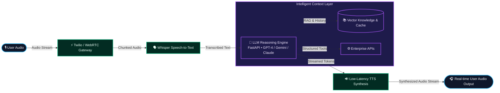
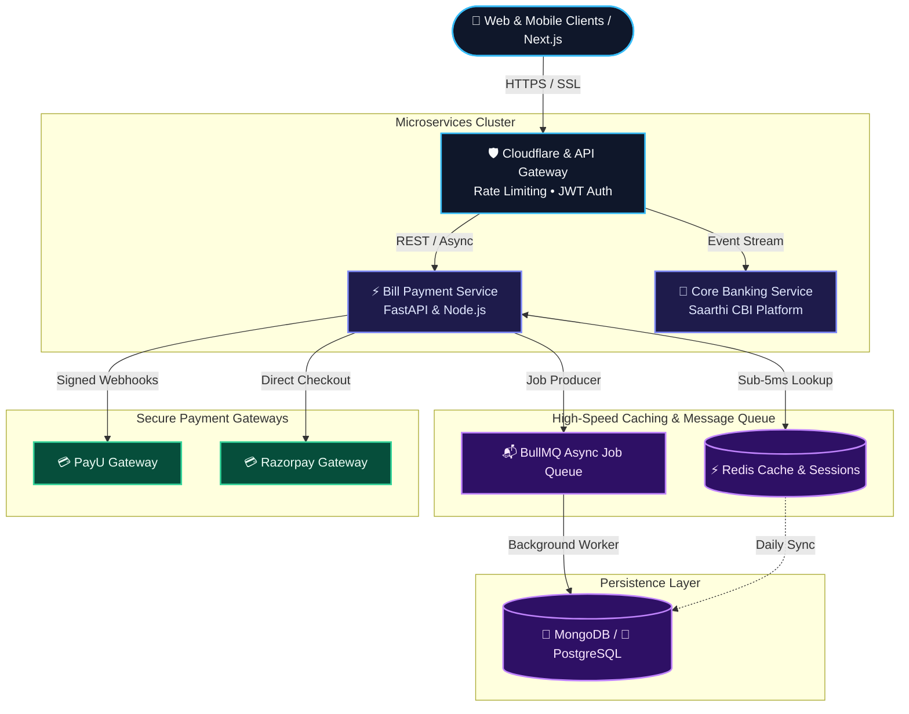
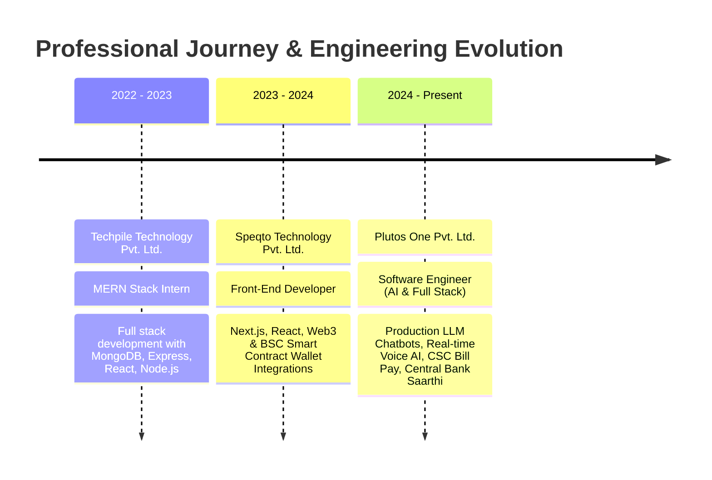

  <!-- Visual Hero Banner (Native Vector SVG) -->
  

    

  <!-- Dynamic Typing Subtitle -->
  

  

    <strong>Production-grade AI systems • Real-time voice intelligence • High-throughput fintech microservices</strong>
  

  <!-- Quick Action Badges -->
  

    
    &nbsp;
    
    &nbsp;
    
    &nbsp;
    
  

  

    
    &nbsp;
    
    &nbsp;
    
  

---

### 👨‍💻 Executive Summary

I am an **AI & ML Engineer and Full Stack Architect** with **3+ years of production experience** delivering enterprise web applications, real-time voice workflows, and high-throughput backend services.

- 🔭 **Current Position**: Software Engineer at **Plutos One Pvt. Ltd.** (Feb 2024 – Present).
- 🧠 **AI & LLM Workflows**: Designing multi-agent pipelines, prompt chaining, automated call monitoring, and intelligent conversational agents (*Visa Chatbot*, *CSC Chatbot*).
- 🎙️ **Real-Time Voice Systems**: Engineering low-latency voice pipelines with **FastAPI, WebRTC, Twilio, Whisper (STT), and TTS**.
- ⚡ **Scale & Performance**: Architected high-availability services for the CSC Bill Payment Platform with substantial throughput optimizations via Redis caching and microservices tuning.
- 💳 **Fintech & Banking**: Hands-on with **Central Bank of India (Saarthi)**, **SVC Bill Pay Platform**, and secure payment integrations (**PayU, Razorpay**).
- 🌐 **Frontend Excellence**: Architected 30+ responsive, production-ready enterprise pages using **Next.js (App & Page Router)**, **React.js**, **TypeScript**, and **Tailwind CSS**.

---

### 🏛️ Visual System Architecture Blueprints

#### 🔹 1. Real-Time Conversational Voice AI Pipeline

#### 🔹 2. High-Throughput Fintech & Payment Engine

---

### 🛠️ Tech Stack & Ecosystem

| Domain | Technologies & Frameworks |
| :--- | :--- |
| **🤖 AI / ML & Real-Time Voice** | `LLM Integration (Gemini, GPT, Claude)` • `LangChain` • `Prompt Engineering` • `Whisper (STT)` • `ElevenLabs (TTS)` • `WebRTC` • `Twilio` • `AI Call Analysis` |
| **⚡ Frontend Engineering** | `Next.js (App & Page Router)` • `React.js` • `TypeScript` • `JavaScript (ES6+)` • `Redux Toolkit` • `Tailwind CSS` • `ShadCN UI` • `Radix UI` • `SCSS` • `Vite` |
| **🏗️ Backend & Microservices** | `FastAPI` • `Node.js` • `Express.js` • `NestJS` • `RESTful API Architecture` • `Microservices` • `WebSockets` • `BullMQ` |
| **🗄️ Databases & Caching** | `MongoDB` • `MySQL` • `PostgreSQL` • `Redis (Caching & Queue Management)` |
| **☁️ Cloud & DevOps** | `Google Cloud Platform (GCP)` • `AWS (EC2, S3)` • `Docker` • `Git` • `GitHub Actions` • `Postman` • `VS Code` |
| **💳 Fintech & Integrations** | `PayU` • `Razorpay` • `Web3 / BSC Smart Contract Integration` • `Decentralized Wallet Workflows` |

 

<!-- Modern Icon Grid -->

   
  

---

### 🚀 Key Production & AI Projects

<table>
  <tr>
    <td width="50%" valign="top">
      <h3>🎙️ AI Voice Assistant & Call Insights</h3>
      
Real-time voice intelligence pipeline powering low-latency bi-directional voice agents and automated call workflows.

      <ul>
        <li>Sub-second end-to-end voice latency using <strong>FastAPI, WebRTC, Twilio, STT & TTS</strong>.</li>
        <li>Automated root cause analysis and sentiment scoring via LLM-based post-call processing.</li>
        <li>Dynamic prompt chaining for structured task completion and CRM syncing.</li>
      </ul>
      

        
        
        
        
      

    </td>
    <td width="50%" valign="top">
      <h3>🌍 Multi-Country Visa & CSC AI Chatbots</h3>
      
Enterprise AI conversational assistants deployed across multiple countries and the nationwide CSC network.

      <ul>
        <li>Provides instant query resolution for international visa requirements and government bill services.</li>
        <li>High-accuracy contextual retrieval using structured knowledge schemas.</li>
        <li>Substantially slashed manual ticket resolution times across thousands of daily user interactions.</li>
      </ul>
      

        
        
        
      

    </td>
  </tr>
  <tr>
    <td width="50%" valign="top">
      <h3>💳 CSC & SVC Bill Payment Platforms</h3>
      
Mission-critical fintech infrastructure powering nationwide utility bill payment workflows.

      <ul>
        <li>Engineered full-stack services using <strong>Node.js, Express, MongoDB, and Redis</strong>.</li>
        <li>Achieved substantial throughput optimization using Redis query caching, connection pooling, and payload compression.</li>
        <li>Bulletproof payment integrations with <strong>PayU and Razorpay</strong> with robust webhook reconciliation.</li>
      </ul>
      

        
        
        
      

    </td>
    <td width="50%" valign="top">
      <h3>🏦 Saarthi – Central Bank of India Platform</h3>
      
Next-generation digital banking platform engineered for maximum security, compliance, and seamless customer onboarding.

      <ul>
        <li>Architected mission-critical financial web journeys with <strong>Next.js, React, and TypeScript</strong>.</li>
        <li>Strict adherence to banking grade UI state management, accessibility, and zero-trust data security.</li>
        <li>Cross-functional collaboration with core banking backend and security audit teams.</li>
      </ul>
      

        
        
        
      

    </td>
  </tr>
  <tr>
    <td width="50%" valign="top">
      <h3>✈️ Best Sky Fare (<a href="https://bestskyfare.com" target="_blank">bestskyfare.com</a>)</h3>
      
Comprehensive travel booking engine featuring live search, booking workflows, and responsive travel management.

      <ul>
        <li>Modern, responsive frontend built with <strong>Next.js and Tailwind CSS</strong>.</li>
        <li>High-speed flight aggregation and booking workflows backed by <strong>FastAPI</strong> services.</li>
        <li>Optimized for SEO, core web vitals, and instant mobile load speeds.</li>
      </ul>
      

        
        
        
      

    </td>
    <td width="50%" valign="top">
      <h3>🔗 Web3 & Bound Finance Systems</h3>
      
Decentralized finance frontend modules and smart contract wallet integrations.

      <ul>
        <li>Integrated non-custodial wallet connectors (MetaMask, WalletConnect) with BSC contracts.</li>
        <li>Built real-time transaction event listeners and state synchronization engines.</li>
      </ul>
      

        
        
        
      

    </td>
  </tr>
</table>

---

### 💼 Career Milestones & Engineering Impact

---

### 📊 GitHub Activity & Statistics

  <table border="0" style="border: none; background: transparent;">
    <tr style="border: none; background: transparent;">
      <td align="center" style="border: none; padding: 10px;">
        
      </td>
      <td align="center" style="border: none; padding: 10px;">
        
      </td>
    </tr>
  </table>

---

### 🤝 Let's Connect & Collaborate

  <!-- Connect Call-to-Action Banner -->
  

    

  <!-- Clean 4-Column Interactive Contact Grid -->
  <table border="0" style="border: none; width: 100%; max-width: 850px;">
    <tr align="center" style="border: none;">
      <td width="25%" style="padding: 16px; border: 1px solid #30363d; border-radius: 8px;">
        <a href="https://linkedin.com/in/satish-chaubey" target="_blank">
            
          <strong>LinkedIn</strong> 
          Career &amp; Network  
          
        </a>
      </td>
      <td width="25%" style="padding: 16px; border: 1px solid #30363d; border-radius: 8px;">
        <a href="https://satishchaubey.vercel.app" target="_blank">
            
          <strong>Portfolio</strong> 
          Live Demos &amp; Work  
          
        </a>
      </td>
      <td width="25%" style="padding: 16px; border: 1px solid #30363d; border-radius: 8px;">
        <a href="mailto:satishchaubey02@gmail.com">
            
          <strong>Direct Email</strong> 
          Opportunities &amp; Chat  
          
        </a>
      </td>
      <td width="25%" style="padding: 16px; border: 1px solid #30363d; border-radius: 8px;">
        <a href="https://github.com/satishchaubey">
            
          <strong>GitHub</strong> 
          Repos &amp; Open Source  
          
        </a>
      </td>
    </tr>
  </table>

   

  ⚡ <i>"Building resilient, low-latency architectures that bridge cutting-edge AI models with production-grade reliability."</i>

