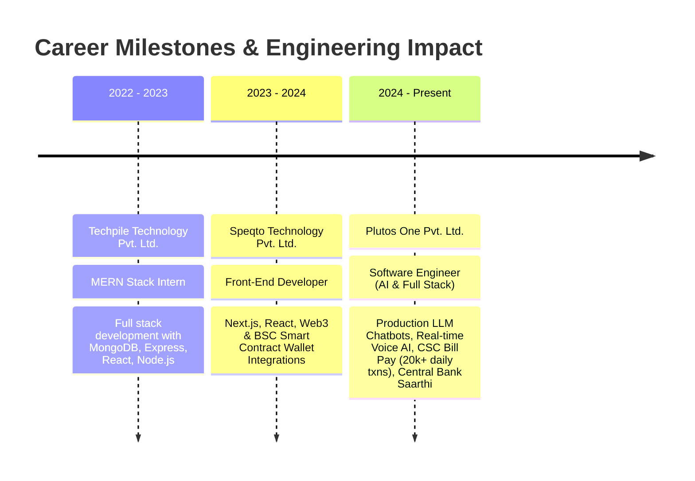

<div align="center">

  <!-- Header Banner / Typing Animation -->
  <a href="https://satishchaubey.vercel.app" target="_blank">
    
  </a>

  <p align="center">
    <strong>Crafting production-grade AI systems, real-time voice intelligence, and scalable microservices handling 20,000+ daily transactions.</strong>
  </p>

  <!-- Connect Badges -->
  <p align="center">
    <a href="https://satishchaubey.vercel.app" target="_blank">
      
    </a>
    <a href="https://linkedin.com/in/satish-chaubey" target="_blank">
      
    </a>
    <a href="mailto:satishchaubey02@gmail.com">
      
    </a>
    <a href="https://github.com/satishchaubey">
      
    </a>
  </p>

  <p align="center">
    
    &nbsp;
    
    &nbsp;
    
  </p>

</div>

---

### 👨‍💻 About Me

I am an **AI & ML Engineer and Full Stack Architect** with **3+ years of production experience** delivering enterprise web applications, real-time voice workflows, and high-throughput backend services. 

- 🔭 **Current Position**: Software Engineer at **Plutos One Pvt. Ltd.** (Feb 2024 – Present).
- 🧠 **AI & LLM Workflows**: Designing multi-agent pipelines, prompt chaining, automated call monitoring, and intelligent conversational agents (Visa Chatbot, CSC Chatbot).
- 🎙️ **Real-Time Voice Systems**: Engineering low-latency voice pipelines with **FastAPI, WebRTC, Twilio, Whisper (STT), and TTS**.
- ⚡ **Scale & Performance**: Built services for the CSC Bill Payment Platform handling **20,000+ transactions/day** with **20% performance improvement** via Redis caching and microservices optimization.
- 💳 **Fintech & Banking**: Hands-on with **Central Bank of India (Saarthi)**, **SVC Bill Pay (10,000+ txns/day)**, and secure payment integrations (**PayU, Razorpay**).
- 🌐 **Frontend Excellence**: Architected 30+ responsive, production-ready enterprise pages using **Next.js (App & Page Router)**, **React.js**, **TypeScript**, and **Tailwind CSS**.

---

### 🛠️ Tech Stack & Ecosystem

<div align="center">

| Domain | Technologies & Frameworks |
| :--- | :--- |
| **🤖 AI / ML & Real-Time Voice** | `LLM Integration (Gemini, GPT, Claude)` • `LangChain` • `Prompt Engineering` • `Whisper (STT)` • `ElevenLabs (TTS)` • `WebRTC` • `Twilio` • `AI Call Analysis` |
| **⚡ Frontend Engineering** | `Next.js (App & Page Router)` • `React.js` • `TypeScript` • `JavaScript (ES6+)` • `Redux Toolkit` • `Tailwind CSS` • `ShadCN UI` • `Radix UI` • `SCSS` • `Vite` |
| **🏗️ Backend & Microservices** | `FastAPI` • `Node.js` • `Express.js` • `NestJS` • `RESTful API Architecture` • `Microservices` • `WebSockets` • `BullMQ` |
| **🗄️ Databases & Caching** | `MongoDB` • `MySQL` • `PostgreSQL` • `Redis (Caching & Queue Management)` |
| **☁️ Cloud & DevOps** | `Google Cloud Platform (GCP)` • `AWS (EC2, S3)` • `Docker` • `Git` • `GitHub Actions` • `Postman` • `VS Code` |
| **💳 Fintech & Integrations** | `PayU` • `Razorpay` • `Web3 / BSC Smart Contract Integration` • `Decentralized Wallet Workflows` |

<br/>

<!-- Modern Icon Grid -->
<p align="center">
  <br/>
  
</p>

</div>

---

### 🏛️ System Architecture Blueprints

#### 🔹 1. Real-Time Conversational AI & Voice Pipeline
```
[User Audio] ──> [Twilio / WebRTC] ──> [Speech-to-Text (Whisper)]
                                              │
                                              ▼
[Synthesized Speech] <── [Text-to-Speech] <── [LLM Reasoning Engine (FastAPI / Gemini / GPT)]
       │                                              │
       └──> Low-Latency Audio Streaming Back <────────┴── [Context & Tool Chaining]
```

#### 🔹 2. High-Throughput Fintech & Payment Engine (20K+ Daily Txns)
```
[User / Next.js Client] ──> [API Gateway (Load Balanced)] ──> [FastAPI / Node.js Microservices]
                                                                        │
                                   ┌────────────────────────────────────┴────────────────────────────────────┐
                                   ▼                                                                         ▼
                      [Redis Cache & Rate Limiter]                                            [PayU / Razorpay Secure Flow]
                                   │                                                                         │
                                   ▼                                                                         ▼
                      [MongoDB / PostgreSQL Cluster] <───────── [BullMQ Asynchronous Workers] ───────────────┘
```

---

### 🚀 Key Production & AI Projects

<table>
  <tr>
    <td width="50%" valign="top">
      <h3>🎙️ AI Voice Assistant & Call Insights</h3>
      <p>Real-time voice intelligence pipeline powering low-latency bi-directional voice agents and automated call workflows.</p>
      <ul>
        <li>Sub-second end-to-end voice latency using <strong>FastAPI, WebRTC, Twilio, STT & TTS</strong>.</li>
        <li>Automated root cause analysis and sentiment scoring via LLM-based post-call processing.</li>
        <li>Dynamic prompt chaining for structured task completion and CRM syncing.</li>
      </ul>
      <p>
        
        
        
        
      </p>
    </td>
    <td width="50%" valign="top">
      <h3>🌍 Multi-Country Visa & CSC AI Chatbots</h3>
      <p>Enterprise AI conversational assistants deployed across multiple countries and the nationwide CSC network.</p>
      <ul>
        <li>Provides instant query resolution for international visa requirements and government bill services.</li>
        <li>High-accuracy contextual retrieval using structured knowledge schemas.</li>
        <li>Substantially slashed manual ticket resolution times across thousands of daily user interactions.</li>
      </ul>
      <p>
        
        
        
      </p>
    </td>
  </tr>
  <tr>
    <td width="50%" valign="top">
      <h3>💳 CSC & SVC Bill Payment Platforms</h3>
      <p>Mission-critical fintech infrastructure processing <strong>20,000+ daily transactions</strong> for utility bill payments.</p>
      <ul>
        <li>Engineered full-stack services using <strong>Node.js, Express, MongoDB, and Redis</strong>.</li>
        <li>Achieved a <strong>20% throughput boost</strong> using Redis query caching, connection pooling, and payload compression.</li>
        <li>Bulletproof payment integrations with <strong>PayU and Razorpay</strong> with robust webhook reconciliation.</li>
      </ul>
      <p>
        
        
        
      </p>
    </td>
    <td width="50%" valign="top">
      <h3>🏦 Saarthi – Central Bank of India Platform</h3>
      <p>Next-generation digital banking platform engineered for maximum security, compliance, and seamless customer onboarding.</p>
      <ul>
        <li>Architected mission-critical financial web journeys with <strong>Next.js, React, and TypeScript</strong>.</li>
        <li>Strict adherence to banking grade UI state management, accessibility, and zero-trust data security.</li>
        <li>Cross-functional collaboration with core banking backend and security audit teams.</li>
      </ul>
      <p>
        
        
        
      </p>
    </td>
  </tr>
  <tr>
    <td width="50%" valign="top">
      <h3>✈️ Best Sky Fare (<a href="https://bestskyfare.com" target="_blank">bestskyfare.com</a>)</h3>
      <p>Comprehensive travel booking engine featuring live search, booking workflows, and responsive travel management.</p>
      <ul>
        <li>Modern, responsive frontend built with <strong>Next.js and Tailwind CSS</strong>.</li>
        <li>High-speed flight aggregation and booking workflows backed by <strong>FastAPI</strong> services.</li>
        <li>Optimized for SEO, core web vitals, and instant mobile load speeds.</li>
      </ul>
      <p>
        
        
        
      </p>
    </td>
    <td width="50%" valign="top">
      <h3>🔗 Web3 & Bound Finance Systems</h3>
      <p>Decentralized finance frontend modules and smart contract wallet integrations.</p>
      <ul>
        <li>Integrated non-custodial wallet connectors (MetaMask, WalletConnect) with BSC contracts.</li>
        <li>Built real-time transaction event listeners and state synchronization engines.</li>
      </ul>
      <p>
        
        
        
      </p>
    </td>
  </tr>
</table>

---

### 💼 Experience Timeline



---

### 📊 GitHub Activity & Statistics

<div align="center">
  <table border="0">
    <tr>
      <td>
        
      </td>
      <td>
        
      </td>
    </tr>
  </table>

  <br/>

  <a href="https://github.com/satishchaubey">
    
  </a>
</div>

---

### 🤝 Let's Connect & Collaborate

Whether you're looking to discuss **Production AI / LLM Workflows**, **Real-Time Voice Architecture**, or **High-Scale Web Engineering**, my inbox is always open!

<div align="center">

  <a href="https://satishchaubey.vercel.app" target="_blank">
    
  </a>
  &nbsp;
  <a href="https://linkedin.com/in/satish-chaubey" target="_blank">
    
  </a>
  &nbsp;
  <a href="mailto:satishchaubey02@gmail.com">
    
  </a>

  <br/><br/>

  <sub>⚡ <i>"Building resilient, low-latency architectures that bridge cutting-edge AI models with production-grade reliability."</i></sub>

</div>
